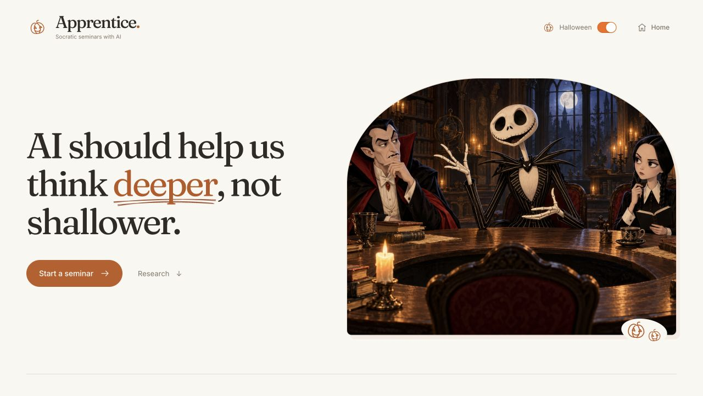

# APPRENTICE

Practice a Socratic seminar without needing a room full of people. A facilitator and two AI peers
question each other, test assumptions, and leave room for you to change the discussion. The
default presentation is a candlelit Halloween seminar with Jack Skellington as host,
with Count Dracula and Wednesday Addams as peers. The top-right toggle switches to a classroom. The point is to practice contributing to a
conversation, not to obtain an answer from a tutor.

This is a localhost Haunted Hacks demo. Three speaking AI participants and one silent evidence
worker share a durable room with one human seat. Software engineering is the main demonstration;
the same Socratic practice can use mathematics, general knowledge, and custom questions.
The product has one learning format: a Socratic seminar. Observe, participate, and lead change
how often the agents offer you the floor. Theme changes affect the presentation and character
direction, not the learning format. Old saved debate/exploration settings remain readable for
compatibility; new rooms created through the interface are Socratic.

The demo homepage introduces “Apprentice — Socratic seminars with AI,” explains the learning
objective, links to primary research with its limitations, and shows how Terse and Agent Relay
coordinate the discussion. The top-right Home button leaves the room and returns to that page.



## Run locally

Bun **1.4.4** is pinned in `devDependencies`; the dev launcher uses the repository's Bun binary
for the UI, backend, Terse runtime, and agent workers. After the initial install, use that binary for reproducible commands.

```sh
bun install --frozen-lockfile
./node_modules/.bin/bun install --cwd actor --frozen-lockfile
```

If `.env.hackathon.local` does not already exist, copy `.env.hackathon.example` to it. Preserve an
existing file. Fill in only the credentials issued for this hackathon:

- `HACKATHON_OPENAI_API_KEY` and `HACKATHON_OPENAI_MODEL`.
- `HACKATHON_ELEVENLABS_API_KEY` and the three `HACKATHON_VOICE_*` IDs.
- `HACKATHON_RELAY_WORKSPACE_KEY`, or run the bootstrap command below to create a dedicated workspace.
- `APP_MODE=live` to require complete provider configuration at startup.

```sh
./node_modules/.bin/bun run relay:bootstrap
./node_modules/.bin/bun run elevenlabs:voices
./node_modules/.bin/bun run dev
```

Bootstrap is only needed when a Relay workspace is not already configured. The voices command
lists voices available in the configured ElevenLabs account; it does not choose or clone one.
The dev command also attempts workspace bootstrap when needed.

Open **http://127.0.0.1:5173**. The backend listens on **3001**, and the Terse local runtime on
**7100**. Keep these ports available. Ctrl+C stops the local services together. Starting a seminar
unlocks browser audio; microphone use requires the browser's permission. Typed participation and
captions are available if microphone access is unavailable. Click **Jump in**, speak, and pause for
about 1.5 seconds: the final transcript sends automatically and the microphone closes before the
agents reply. **Done speaking** remains available to submit sooner.

## Check the implementation

```sh
./node_modules/.bin/bun run typecheck
./node_modules/.bin/bun run lint
./node_modules/.bin/bun run test
./node_modules/.bin/bun run build:web
```

These checks do not establish that live providers work. Unit tests use injected transports or
fixtures and cover stale proposals, exclusive floor control, interrupted prefixes, human
corrections, board dismissal, model-output validation, evidence boundaries, and payment cases.

The opt-in Terse restart test starts an isolated real runtime on an automatically selected port,
persists an interrupted turn, restarts that runtime, and verifies recovery. It does not call paid providers:

```sh
./node_modules/.bin/bun run test:integration
```

For a repeatable expiry-and-restart rehearsal, with temporary state and no changes to running rooms:

```sh
./node_modules/.bin/bun scripts/rehearseTerseRecovery.ts
```

This also checks real actor-alarm expiry, lease renewal, pushed public snapshots, rejected late
playback acknowledgements, subscription reconnect, and preserved outbox/deduplication state.
The installed local Terse runtime did not automatically fire an overdue alarm after a cold
restart in our probe. Explicit restart recovery and the backend watchdog therefore remain required.

To rehearse an actual backend process crash during an utterance:

```sh
./node_modules/.bin/bun --no-env-file scripts/rehearseBackendRecovery.ts
```

This starts an isolated backend and real Terse runtime with temporary state and fixture reasoning,
Relay, and voice. It acknowledges only the first of two speech segments, kills its own backend
process, restarts it, and checks that the same room returns paused with the exact heard prefix.
It rejects stale playback callbacks, checks that no speech replays automatically, and explicitly
resumes into a fresh reply. It never stops the running demo or uses its provider credentials.
This verifies real Terse durability across a backend crash; it is not a live-provider or audio test.

With the app already running and live provider credentials configured, this explicit smoke
check creates a new room and spends OpenAI/Relay usage:

```sh
./node_modules/.bin/bun run test:live
```

It requires live OpenAI, Agent Relay, and Terse labels; observes real proposal and contribution
Relay IDs; acknowledges three AI turns in order; submits a human contribution; requires the next
reply to reference that actual contribution; checks the stable-key experiment produces one
charge; and ends the room. It has a 120-second limit and pauses/closes on failure or cancellation.
It prints provider labels, heard text, causal IDs, timings, and the evidence result. It never
prints the room token or provider keys.

**This is a text-only protocol smoke.** Its playback acknowledgements mean logical delivery, not
that audio was heard. It does not verify ElevenLabs sound quality, browser playback, microphone
transcription, or perceived conversational latency. Check those in the browser separately.
Passing unit tests or reading this README is not evidence that the live smoke has passed.

## Credentials and fixture modes

The application reads exactly `.env.hackathon.local` and its dedicated `.local` Relay files.
It does not fall back to inherited `OPENAI_API_KEY`, `ELEVENLABS_API_KEY`, Bedside credentials,
other projects' dotenv files, or provider SDK defaults. The dev launcher gives child processes a
small environment containing OS essentials. Provider requests use explicit configuration.

`APP_MODE=fixture` permits a **mixture** of configured live providers and missing-provider
fixtures; it does not force everything offline. Missing OpenAI configuration gives scripted
reasoning, missing voice configuration gives labelled browser speech/text input, and missing
Relay configuration gives an in-memory transport. Terse still runs locally. Each provider's
actual mode is shown in the interface. A Relay or reasoning failure during a live seminar
pauses it visibly; it does not silently change to a simulated conversation.

`HACKATHON_CACHE_OPENING=true` explicitly enables reuse of the first three OpenAI-generated
turns (Jack, Dracula, Wednesday) in an untouched **The payment that vanished** room. It is off
by default. The first eligible run generates them live; matching fresh rooms can reuse them for
seven days. A peer's cache entry must match the exact preceding heard words and board content.
Theme, difficulty, participation, sources, model, reasoning settings and prompt version also
form the key. Reply and board references are rebound to the current room's IDs. Any human
input, interruption, pause/resume, reading, custom topic, evidence or later turn bypasses this
reasoning cache. Entries are validated and limited to 12 private files in `.local/opening-cache/`.

The provider label says **opening exchange cache enabled, replies live**, and each hit adds
`opening.cache-hit` to the trace. For a warmed demo, say: “The introduction is cached; replies
after you join are live.” Approved speech uses a separate exact-request audio cache, so matching
voice, model, settings and text reuse previously generated audio. Neither
cache allows a peer to respond to unheard words or bypasses Relay and Terse floor approval.

Run `bun --no-env-file scripts/rehearseVoiceDemo.ts` to warm this exact Halloween demo and
verify a second fresh room reuses all three opening turns and their audio with valid reply links.
This bounded transport rehearsal uses real providers and logical playback acknowledgements,
not microphone input or an audio audition. Both of its test rooms are paused afterward.

The local Relay workspace and identity files are owner-readable and gitignored. The backend
stores only hashes of room tokens in its registry; the browser keeps the room token to reconnect.
Terse state lives under `actor/.durable-actors/`; the registry is under `.local/`. Deleting either
removes part of the local demo's recovery state. No external application database is required.

To start with fresh local rooms, stop the development services and run
`./node_modules/.bin/bun run reset:local`. It archives room state and the room registry under
`.local/backups/`, preserving hackathon credentials and Relay identities.

## What the sponsor products actually do

```text
React browser (:5173)
    ⇅ backend WebSocket: public snapshots, speech commands, playback acks, controls
Bun backend (:3001)
    ├─ explicit HTTP actor calls / backend-only snapshot subscription ↔ Terse (:7100)
    ├─ agent channel posts and proposal/evidence DMs → Agent Relay
    ├─ independent, validated participant proposals → OpenAI Responses
    └─ approved speech segments / live transcription tokens → ElevenLabs
```

**Terse** owns the transcript, reasoning board, evidence, lifecycle, exclusive speaker lease,
version, cancellation epoch, event deduplication, and pending outbound messages. A single
persisted JSON field is reassigned after each pure transition. Serialized actor calls prevent
two speakers from holding the floor. The room state and its next alarm are committed together.
An actor alarm pauses an expired speaker lease or moves an expired session into reflection;
both preserve only the heard prefix. The backend subscribes to public actor snapshots and forwards
them over its own WebSocket, stopping stale audio on epoch changes. The browser does not connect
directly to Terse. The server watchdog remains a fallback, including after local runtime restart.

**Agent Relay** is the causal path between participants. The speaking identities are
`facilitator`, `maya`, and `theo`; `evidence` runs deterministic tools. `bridge` coordinates the
floor and `learner` carries your turns. A heard contribution is posted by its speaker, a peer
receives it, and that peer sends a proposal to the bridge through Relay. Evidence requests and
results also travel through Relay. The live Agents panel displays real message IDs, routes,
proposals, floor ownership, and recovery events. With live Relay configured, the dev launcher
runs the facilitator, Maya, Theo, and evidence worker in four separate Bun processes. Only the
coordinator owns the browser connection and selects turns; each worker owns its own Relay delivery
pump and private notes. The coordinator cannot generate speaking proposals in distributed mode.

**OpenAI** generates short structured proposals and the closing reflection. References are
checked against heard contributions, topic sources, and real tool cases. A reflection cannot
credit an AI statement as your changed belief. **ElevenLabs** supplies the selected voice only
after a proposal wins the floor, and Scribe transcribes the human microphone turn.

An oversized spoken contribution gets one attempt to produce a shorter, complete response.
Transport retries and this correction share a maximum of two HTTP attempts per proposal and
one 45-second deadline. The room's proposal counter counts accepted proposals, not HTTP attempts.

Only finished playback segments enter shared conversational context. Jumping in stops local
audio, revokes the floor, advances the epoch, and preserves the heard prefix. A partial AI turn
does not add its proposed board claim. Human corrections supersede the old contribution and
mark dependent cards stale. A refresh or backend restart restores history in a paused state;
audio is not replayed automatically.

Switching theme during a discussion revokes the current speech lease and cancels stale work.
The heard prefix remains, and the human keeps the floor if they already had it. Changing the
theme of a paused or ended room does not resume it. Older rooms without a saved theme use classroom.

Supabase, Freestyle, and Superserve are not required or represented as active integrations in
this local demo. Detailed contracts and implementation notes are in `docs/ARCHITECTURE.md`.

## Halloween cast and voice direction

| Character | Seminar role | ElevenLabs selection direction |
|---|---|---|
| Jack Skellington | Warm, curious host who invites the human into the discussion | Alaric — Intense and Theatrical (`gUU37agQvEpxeWrZUIMk`) |
| Count Dracula | Confident peer who advances a position and can revise it | Paul — Transylvanian accent (`5BZv9Z02hAMUmkkcd5Hj`) |
| Wednesday Addams | Precise skeptic who probes assumptions and counterexamples | Nayva — Deep, Intense, Warm, Storyteller (`cfc7wVYq4gw4OpcEEAom`) |

The illustrations and performance direction are character-inspired. The configured voices are
selected ElevenLabs voices, **not clones of the actors who portray these characters**, and are
not claimed to reproduce an original performance. Audition the actual account's available
voices before setting `HACKATHON_VOICE_FACILITATOR`, `HACKATHON_VOICE_MAYA`, and
`HACKATHON_VOICE_THEO`. Keep the three voices audibly distinct and intelligible at a shared volume.

The live library search on October 31, 2026 returned no exact-name listing for these three
characters. All three selected IDs generated successfully with the user's updated paid key,
read only from `.env.hackathon.local`. They work directly with TTS permission; adding them to
the account's voice collection is unnecessary. A free account rejected library TTS with HTTP 402.
`bun --no-env-file scripts/selectCharacterVoices.ts --library` verifies short samples before
changing the three local voice IDs; `--stock` selects a working stock fallback instead.
Delivery settings distinguish Jack's expression from Wednesday's restraint. Following the
audition, Jack and Wednesday use Multilingual v2 at normal speed with steadier settings;
Dracula retains Flash v2.5 and his original settings. Per-seat model overrides are
`HACKATHON_TTS_MODEL_FACILITATOR` and `HACKATHON_TTS_MODEL_THEO`. The speech cache hashes the
resolved model and settings, so old choppy recordings cannot be reused under the new profile.

**Jump in** (or J/Space outside a form control) stops AI playback and starts the microphone in
the same gesture. **Done speaking** mutes input, finishes transcription, and closes capture.
Cancel, pause, disconnect and leaving also close it. Permanent permission is a browser setting
for the exact origin; allow the microphone for `http://127.0.0.1:5173`. Nothing records on load.

## A three-minute software-engineering demo

1. **0:00–0:20 — Take the empty seat.** Choose software engineering / “The payment that vanished,”
   intermediate, participate, and the Halloween theme. Say: “I wanted to practice speaking in a seminar,
   but I didn't have a seminar to join.” Point out the live provider indicators.
2. **0:20–1:05 — Let the characters talk to each other.** Jack frames a checkout timeout;
   Dracula proposes a retry; Wednesday questions what a timeout proves. Let the actual generated
   exchange run. Their wording and timing are not fixed or guaranteed.
3. **1:05–1:40 — Make your intervention matter.** Jump in and say or type: “The timeout does not
   prove failure. Reuse the same idempotency key for the same purchase.” Address Dracula. Let the
   next reply engage with your specific claim. Show its parent contribution in the transcript.
4. **1:40–2:20 — Test the assumption.** Run “No key,” “Reuse the same key,” and “New key each
   attempt.” The deterministic experiment returns **2, 1, and 2 charges**, respectively. Explain
   that this demonstrates the simulated server's deduplication contract; a header alone does not
   make arbitrary payment systems safe. Watch the evidence enter the reasoning board.
5. **2:20–3:00 — Show the mechanism and the learning.** Briefly open “Behind the discussion” to
   show real Relay message IDs and Terse's exclusive floor. End & reflect. Highlight something you
   actually contributed, or the next unanswered question; do not claim you changed your mind if
   you did not. Close with: “The scary part was never the topic. It was speaking up.”

## Current limits

One human controls a room; opening the same room in another tab replaces the first connection.
Multi-human networking, hosted deployment, and durable private agent notes are not implemented.
The configured Relay host currently rejects WebSockets with HTTP 501. The adapter therefore
uses durable polling and labels it honestly. It supports node WebSockets, reconnect, deferred
acknowledgement and bounded reconciliation when available; delivery and model latency remain variable. Custom topics can
use supplied reading but do not acquire verified sources automatically. Tools are bounded local
demonstrations, not a universal fact checker. Provider configuration is checked at startup;
successful live behavior still needs the explicit smoke and browser checks above.

The live text-protocol smoke passed on October 31: three AI turns, an answer referencing the
human's contribution, a real Relay evidence delivery, and a completed reflection in about 27
seconds. Browser testing also exercised ElevenLabs playback and theme switching. Microphone
capture has not been manually verified. Re-run the checks after changing credentials or providers.

## External agent seat

For a local caller-owned agent, reserve Theo instead of starting the built-in Theo worker:

```sh
./node_modules/.bin/bun run dev:external
./node_modules/.bin/bun run worker:external
```

The second command is a JSONL adapter: stdout emits `turn.request` with a `requestId` and
`context`; stdin accepts `{ "requestId": "<matching id>", "draft": { ... } }`. Connect those
streams to your own agent process. Drafts follow `ProposalDraftSchema` in `shared/contracts.ts`.
They are validated against the actual topic, heard transcript, sources, and current floor.
A response has a 45-second limit; interruption cancels it. Provider keys are never sent over
this interface. The adapter itself owns the peer's real Relay identity and durable outbox.

Run only one worker per seat. The normal launcher owns all four seats; `dev:external` deliberately
leaves Theo free. The adapter is local JSONL, not a remote guest enrollment service. The browser
still has one human seat. Tests cover response validation, cancellation, independent role
consumption, and delayed actor updates.

The UI uses Radix Themes for controls. Halloween mode uses warm paper, orange accents, and
drawn pumpkins; the top-right switch selects the classroom theme. The landing coordination
walkthrough is explicitly illustrative. The in-room Agents tab uses actual room trace events.
